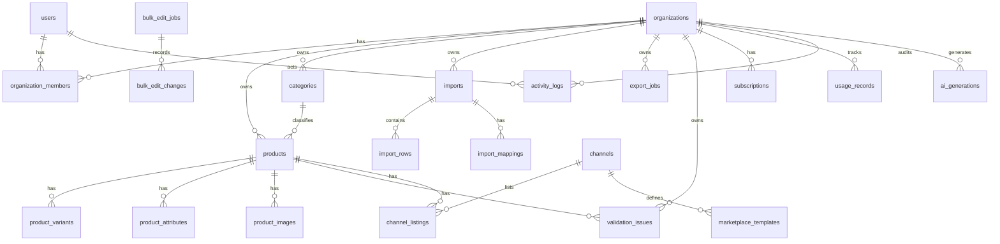

# CatalogPilot — Database Schema

**Version:** 1.0  
**Engine:** PostgreSQL 15+  
**ORM:** Drizzle  
**Tenancy:** Shared database, shared schema, **mandatory `organization_id`** on tenant-owned tables.

---

## 1. Multi-tenant security strategy

1. **Tenant key:** `organizations.id` (UUID).  
2. **Membership:** `organization_members (user_id, organization_id, role)` unique pair.  
3. **Row ownership:** Every tenant-owned table includes `organization_id NOT NULL` FK → `organizations`.  
4. **Access path:** Resolve membership → bind `organization_id` in service layer → all queries filter by it.  
5. **Defense in depth (recommended):**  
   - Application-level filters (required)  
   - Optional Postgres Row Level Security later (V2) — not required for MVP if tests are strong  
6. **Cross-org prevention:** Integration tests attempting Org A token + Org B resource IDs must fail.  
7. **Unique constraints** are **per-organization** (e.g., SKU unique within org, not globally).

---

## 2. ER diagram

---

## 3. Table specifications

> UUID primary keys unless noted. Timestamps: `timestamptz`. Soft delete optional via `deleted_at`.

### 3.1 `users`

**Purpose:** Application users (aligned with Better Auth user table; may be managed by auth schema — keep fields compatible).

| Column | Type | Notes |
|--------|------|-------|
| id | uuid PK | |
| email | text NOT NULL | UNIQUE |
| email_verified | boolean NOT NULL DEFAULT false | |
| name | text | |
| image_url | text | |
| password_hash | text | If credentials in-DB |
| created_at | timestamptz NOT NULL | |
| updated_at | timestamptz NOT NULL | |

**Indexes:** unique `email`

> Auth may also create `sessions`, `accounts`, `verifications` — follow Better Auth schema; do not duplicate.

### 3.2 `organizations`

| Column | Type | Notes |
|--------|------|-------|
| id | uuid PK | |
| name | text NOT NULL | |
| slug | text NOT NULL | UNIQUE |
| default_currency | char(3) NOT NULL DEFAULT 'USD' | |
| created_at | timestamptz | |
| updated_at | timestamptz | |
| deleted_at | timestamptz | soft delete |

### 3.3 `organization_members`

| Column | Type | Notes |
|--------|------|-------|
| id | uuid PK | |
| organization_id | uuid NOT NULL FK → organizations | |
| user_id | uuid NOT NULL FK → users | |
| role | text NOT NULL | `owner` \| `admin` \| `editor` \| `viewer` |
| created_at | timestamptz | |

**Constraints:** UNIQUE `(organization_id, user_id)`  
**Indexes:** `(user_id)`, `(organization_id)`

### 3.4 `organization_invites`

| Column | Type | Notes |
|--------|------|-------|
| id | uuid PK | |
| organization_id | uuid NOT NULL FK | |
| email | text NOT NULL | |
| role | text NOT NULL | |
| token_hash | text NOT NULL | |
| expires_at | timestamptz NOT NULL | |
| accepted_at | timestamptz | |
| created_by | uuid FK → users | |
| created_at | timestamptz | |

**Indexes:** `(organization_id, email)`

### 3.5 `categories`

| Column | Type | Notes |
|--------|------|-------|
| id | uuid PK | |
| organization_id | uuid NOT NULL FK | |
| parent_id | uuid FK → categories | nullable |
| name | text NOT NULL | |
| path | text | materialized path optional |
| created_at | timestamptz | |
| updated_at | timestamptz | |

**Indexes:** `(organization_id, name)`, `(organization_id, parent_id)`

### 3.6 `products`

**Purpose:** Canonical product (parent or standalone).

| Column | Type | Notes |
|--------|------|-------|
| id | uuid PK | |
| organization_id | uuid NOT NULL FK | |
| sku | text NOT NULL | unique per org |
| title | text | |
| description | text | |
| brand | text | |
| category_id | uuid FK → categories | |
| price | numeric(12,2) | |
| currency | char(3) NOT NULL DEFAULT 'USD' | |
| quantity | integer | |
| status | text NOT NULL DEFAULT 'draft' | draft/active/archived |
| barcode | text | UPC/EAN/GTIN normalized |
| barcode_type | text | upc\|ean\|gtin\|other |
| quality_score | integer | 0–100 cached |
| attributes_json | jsonb NOT NULL DEFAULT '{}' | fast flexible attrs |
| source_import_id | uuid FK → imports | nullable |
| created_at | timestamptz | |
| updated_at | timestamptz | |
| deleted_at | timestamptz | |

**Constraints:** UNIQUE `(organization_id, sku)` WHERE deleted_at IS NULL  
**Indexes:**  
- `(organization_id, updated_at DESC)`  
- `(organization_id, status)`  
- `(organization_id, brand)`  
- `(organization_id, barcode)` WHERE barcode IS NOT NULL  
- GIN `(organization_id, attributes_json)` optional later  
- trigram/search: `title` + `sku` via `pg_trgm` **[optional MVP]** or ILIKE with indexes

### 3.7 `product_variants`

| Column | Type | Notes |
|--------|------|-------|
| id | uuid PK | |
| organization_id | uuid NOT NULL FK | denormalized for tenancy filters |
| product_id | uuid NOT NULL FK → products | |
| sku | text NOT NULL | unique per org |
| option1_name | text | e.g. Size |
| option1_value | text | |
| option2_name | text | |
| option2_value | text | |
| option3_name | text | |
| option3_value | text | |
| price | numeric(12,2) | |
| quantity | integer | |
| barcode | text | |
| status | text NOT NULL DEFAULT 'active' | |
| created_at | timestamptz | |
| updated_at | timestamptz | |

**Constraints:** UNIQUE `(organization_id, sku)`  
**Indexes:** `(organization_id, product_id)`

### 3.8 `product_attributes`

**Purpose:** EAV for searchable/typed attributes when JSON is insufficient; MVP may primarily use `attributes_json` and sync important keys here in V1.1.

| Column | Type | Notes |
|--------|------|-------|
| id | uuid PK | |
| organization_id | uuid NOT NULL FK | |
| product_id | uuid NOT NULL FK | |
| key | text NOT NULL | |
| value_text | text | |
| value_number | numeric | |
| value_bool | boolean | |
| unit | text | |

**Constraints:** UNIQUE `(product_id, key)`  
**Indexes:** `(organization_id, key, value_text)`

### 3.9 `product_images`

| Column | Type | Notes |
|--------|------|-------|
| id | uuid PK | |
| organization_id | uuid NOT NULL FK | |
| product_id | uuid NOT NULL FK | |
| url | text NOT NULL | |
| position | integer NOT NULL DEFAULT 0 | |
| alt_text | text | |
| width | integer | |
| height | integer | |
| content_hash | text | V1.1 duplicate detection |
| r2_key | text | null if external URL only |
| status | text | pending\|valid\|invalid |
| created_at | timestamptz | |

**Indexes:** `(organization_id, product_id, position)`, `(organization_id, content_hash)` WHERE content_hash IS NOT NULL

### 3.10 `channels`

**Purpose:** System or org-visible channel definitions (Shopify, Amazon, …).

| Column | Type | Notes |
|--------|------|-------|
| id | uuid PK | |
| code | text NOT NULL UNIQUE | `shopify`, `amazon`, … |
| name | text NOT NULL | |
| type | text NOT NULL | `csv_template` \| `api` |
| is_active | boolean NOT NULL DEFAULT true | |

### 3.11 `marketplace_templates`

| Column | Type | Notes |
|--------|------|-------|
| id | uuid PK | |
| channel_id | uuid NOT NULL FK | |
| version | text NOT NULL | e.g. `2026.1` |
| name | text NOT NULL | |
| mapping_schema | jsonb NOT NULL | field rules |
| is_default | boolean NOT NULL DEFAULT false | |
| created_at | timestamptz | |

**Constraints:** UNIQUE `(channel_id, version)`

### 3.12 `channel_listings`

**Purpose:** Optional per-product channel state (export readiness, external ids). MVP may sparsely use.

| Column | Type | Notes |
|--------|------|-------|
| id | uuid PK | |
| organization_id | uuid NOT NULL FK | |
| product_id | uuid NOT NULL FK | |
| channel_id | uuid NOT NULL FK | |
| external_id | text | |
| status | text | |
| last_exported_at | timestamptz | |
| last_error | text | |

**Constraints:** UNIQUE `(product_id, channel_id)`

### 3.13 `imports`

| Column | Type | Notes |
|--------|------|-------|
| id | uuid PK | |
| organization_id | uuid NOT NULL FK | |
| created_by | uuid FK → users | |
| file_name | text NOT NULL | |
| file_r2_key | text NOT NULL | |
| file_size_bytes | bigint | |
| file_content_hash | text | dedupe detection |
| status | text NOT NULL | uploaded\|mapping\|validated\|queued\|processing\|completed\|failed\|rolled_back |
| encoding | text | |
| delimiter | text | |
| header_row | integer DEFAULT 1 | |
| mode | text NOT NULL | create\|upsert |
| total_rows | integer | |
| success_rows | integer | |
| failed_rows | integer | |
| error_r2_key | text | |
| started_at | timestamptz | |
| finished_at | timestamptz | |
| created_at | timestamptz | |

**Indexes:** `(organization_id, created_at DESC)`, `(organization_id, file_content_hash)`

### 3.14 `import_mappings`

| Column | Type | Notes |
|--------|------|-------|
| id | uuid PK | |
| import_id | uuid NOT NULL FK | |
| organization_id | uuid NOT NULL FK | |
| source_column | text NOT NULL | |
| target_field | text NOT NULL | |
| transform | text | optional transform id |

### 3.15 `import_rows`

**Purpose:** Optional staging for errors/preview; for large files prefer store only **failed rows** + stats to save space.

| Column | Type | Notes |
|--------|------|-------|
| id | uuid PK | |
| import_id | uuid NOT NULL FK | |
| organization_id | uuid NOT NULL FK | |
| row_number | integer NOT NULL | |
| raw_json | jsonb | |
| status | text | preview\|success\|failed\|skipped |
| error_message | text | |
| product_id | uuid FK | if created |

**Indexes:** `(import_id, status)`, `(import_id, row_number)`

**MVP guidance:** Persist failed rows; successful rows may omit raw payload after commit.

### 3.16 `validation_rules`

| Column | Type | Notes |
|--------|------|-------|
| id | uuid PK | |
| organization_id | uuid | NULL = system default |
| code | text NOT NULL | e.g. `missing_title` |
| name | text NOT NULL | |
| description | text | |
| severity | text NOT NULL | critical\|error\|warning\|info |
| is_enabled | boolean NOT NULL DEFAULT true | |
| config_json | jsonb NOT NULL DEFAULT '{}' | |
| created_at | timestamptz | |

**Constraints:** UNIQUE `(organization_id, code)` with care for NULL org (use partial uniques / seed per org on create)

### 3.17 `validation_issues`

| Column | Type | Notes |
|--------|------|-------|
| id | uuid PK | |
| organization_id | uuid NOT NULL FK | |
| product_id | uuid NOT NULL FK | |
| rule_code | text NOT NULL | |
| severity | text NOT NULL | |
| message | text NOT NULL | |
| field | text | |
| status | text NOT NULL DEFAULT 'open' | open\|ignored\|resolved |
| run_id | uuid | validation job id |
| created_at | timestamptz | |
| resolved_at | timestamptz | |

**Indexes:** `(organization_id, status, severity)`, `(organization_id, product_id)`, `(organization_id, rule_code)`

### 3.18 `validation_runs`

| Column | Type | Notes |
|--------|------|-------|
| id | uuid PK | |
| organization_id | uuid NOT NULL FK | |
| status | text | |
| scope | text | all\|selection\|post_import |
| product_count | integer | |
| issue_count | integer | |
| created_by | uuid | |
| created_at | timestamptz | |
| finished_at | timestamptz | |

### 3.19 `bulk_edit_jobs`

| Column | Type | Notes |
|--------|------|-------|
| id | uuid PK | |
| organization_id | uuid NOT NULL FK | |
| created_by | uuid | |
| operation | text NOT NULL | |
| operation_config | jsonb NOT NULL | |
| status | text NOT NULL | |
| product_count | integer | |
| preview_json | jsonb | sample diffs |
| can_rollback | boolean DEFAULT false | |
| created_at | timestamptz | |
| finished_at | timestamptz | |

### 3.20 `bulk_edit_changes`

| Column | Type | Notes |
|--------|------|-------|
| id | uuid PK | |
| bulk_edit_job_id | uuid NOT NULL FK | |
| organization_id | uuid NOT NULL FK | |
| product_id | uuid NOT NULL FK | |
| before_json | jsonb NOT NULL | snapshot subset |
| after_json | jsonb NOT NULL | |
| created_at | timestamptz | |

**Indexes:** `(bulk_edit_job_id)`, `(organization_id, product_id)`

### 3.21 `export_jobs`

| Column | Type | Notes |
|--------|------|-------|
| id | uuid PK | |
| organization_id | uuid NOT NULL FK | |
| created_by | uuid | |
| channel_id | uuid NOT NULL FK | |
| template_id | uuid FK → marketplace_templates | |
| status | text NOT NULL | |
| product_count | integer | |
| file_r2_key | text | |
| error_report_json | jsonb | |
| created_at | timestamptz | |
| finished_at | timestamptz | |

**Indexes:** `(organization_id, created_at DESC)`

### 3.22 `ai_generations` (V1.1)

| Column | Type | Notes |
|--------|------|-------|
| id | uuid PK | |
| organization_id | uuid NOT NULL FK | |
| product_id | uuid FK | |
| created_by | uuid | |
| type | text | title\|description\|bullets\|attributes\|translate\|category |
| prompt_version | text | |
| input_json | jsonb NOT NULL | facts only |
| output_json | jsonb | |
| status | text | pending\|proposed\|approved\|rejected\|failed |
| tokens_in | integer | |
| tokens_out | integer | |
| estimated_cost_usd | numeric(10,6) | |
| model | text | |
| created_at | timestamptz | |
| decided_at | timestamptz | |

### 3.23 `plans`

| Column | Type | Notes |
|--------|------|-------|
| id | uuid PK | |
| code | text UNIQUE | starter\|growth\|pro |
| name | text | |
| stripe_price_id_monthly | text | |
| stripe_price_id_annual | text | |
| is_active | boolean | |
| sort_order | integer | |

### 3.24 `plan_limits`

| Column | Type | Notes |
|--------|------|-------|
| id | uuid PK | |
| plan_id | uuid NOT NULL FK | |
| key | text NOT NULL | max_products, max_import_export_jobs_monthly, max_ai_credits_monthly, max_members, export_templates |
| value_integer | integer | |
| value_json | jsonb | |

**Constraints:** UNIQUE `(plan_id, key)` — **change limits without code deploys**.

### 3.25 `subscriptions`

| Column | Type | Notes |
|--------|------|-------|
| id | uuid PK | |
| organization_id | uuid NOT NULL UNIQUE FK | |
| plan_id | uuid FK → plans | |
| stripe_customer_id | text | |
| stripe_subscription_id | text | |
| status | text NOT NULL | trialing\|active\|past_due\|canceled\|incomplete |
| trial_ends_at | timestamptz | |
| current_period_end | timestamptz | |
| cancel_at_period_end | boolean DEFAULT false | |
| created_at | timestamptz | |
| updated_at | timestamptz | |

### 3.26 `usage_records`

| Column | Type | Notes |
|--------|------|-------|
| id | uuid PK | |
| organization_id | uuid NOT NULL FK | |
| period_start | date NOT NULL | |
| period_end | date NOT NULL | |
| metric | text NOT NULL | products\|import_export_jobs\|ai_credits |
| quantity | integer NOT NULL DEFAULT 0 | |
| updated_at | timestamptz | |

**Constraints:** UNIQUE `(organization_id, period_start, metric)`

### 3.27 `activity_logs`

| Column | Type | Notes |
|--------|------|-------|
| id | uuid PK | |
| organization_id | uuid NOT NULL FK | |
| actor_user_id | uuid | |
| entity_type | text NOT NULL | |
| entity_id | uuid | |
| action | text NOT NULL | |
| metadata_json | jsonb | |
| created_at | timestamptz | |

**Indexes:** `(organization_id, created_at DESC)`, `(organization_id, entity_type, entity_id)`

### 3.28 `product_revisions` (history / versioning)

**Purpose:** Point-in-time product snapshots for history UI and deeper rollback.

| Column | Type | Notes |
|--------|------|-------|
| id | uuid PK | |
| organization_id | uuid NOT NULL FK | |
| product_id | uuid NOT NULL FK | |
| revision | integer NOT NULL | |
| snapshot_json | jsonb NOT NULL | |
| change_source | text | manual\|import\|bulk\|ai\|system |
| changed_by | uuid | |
| created_at | timestamptz | |

**Constraints:** UNIQUE `(product_id, revision)`  
**MVP:** Write revisions on single edits + bulk (subset fields OK); prune older than N days later.

### 3.29 `job_runs` (optional unified queue mirror)

| Column | Type | Notes |
|--------|------|-------|
| id | uuid PK | |
| organization_id | uuid NOT NULL FK | |
| type | text NOT NULL | |
| status | text NOT NULL | |
| payload_json | jsonb | |
| error_message | text | |
| attempts | integer DEFAULT 0 | |
| created_at | timestamptz | |
| updated_at | timestamptz | |

---

## 4. Cross-cutting design notes

### 4.1 Large catalogs (≤50k products)

- List via indexed filters + keyset pagination (`(updated_at, id)`).  
- Avoid `SELECT *` wide joins on list endpoints.  
- Cache `quality_score` on product.  
- Validation/bulk/export always batched (e.g., 200–500 rows).

### 4.2 Variants

- Parent in `products`; SKUs in `product_variants`.  
- Org-level SKU uniqueness across products **and** variants (enforce in service + partial unique indexes / exclusion).  
- MVP UI: up to 3 options.

### 4.3 Dynamic marketplace attributes

- Do **not** add Amazon-specific columns to `products`.  
- Store generic attrs in `attributes_json` / `product_attributes`.  
- Map via `marketplace_templates.mapping_schema` at export time.

### 4.4 Product history

- `activity_logs` for audit trail.  
- `product_revisions` for content snapshots.  
- Bulk: `bulk_edit_changes.before_json`.

### 4.5 Import rollback

1. Tag products with `source_import_id`.  
2. Rollback = soft-delete or hard-delete products created by that import **if** not edited since (compare `updated_at` / revision).  
3. Upserted products: restore from `product_revisions` taken pre-import if available; else mark rollback partial.  
4. Set import `status = rolled_back`.

### 4.6 Data versioning

- Template versions in `marketplace_templates.version`.  
- Validation rule `config_json` versioning via rule rows.  
- AI `prompt_version`.

---

## 5. Seed data (MVP)

- Channels: `shopify` (csv_template), `amazon` (csv_template)  
- Default templates version `2026.1`  
- Plans + plan_limits for starter/growth/pro  
- System validation rules catalog  

---

## 6. Migration strategy

- Drizzle Kit migrations in repo  
- Never edit applied migrations  
- Backfill `organization_id` denormalized columns carefully when adding tables  

---

## 7. Consistency check vs features

| Feature | Tables |
|---------|--------|
| Auth/orgs | users, organizations, members, invites |
| Import | imports, mappings, rows, products, activity_logs |
| Catalog | products, variants, attributes, images, categories, revisions |
| Quality | validation_rules, issues, runs, products.quality_score |
| Bulk | bulk_edit_jobs, changes, revisions |
| Export | export_jobs, channels, templates, listings |
| Billing | plans, plan_limits, subscriptions, usage_records |
| AI V1.1 | ai_generations, usage_records |
