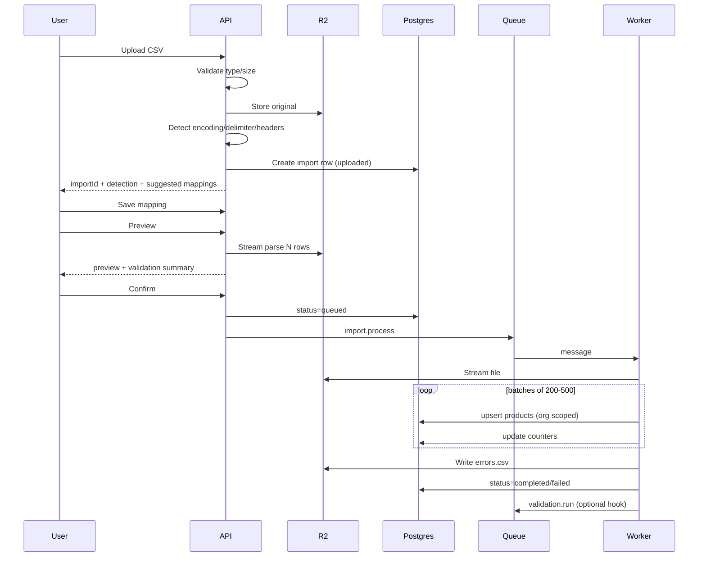
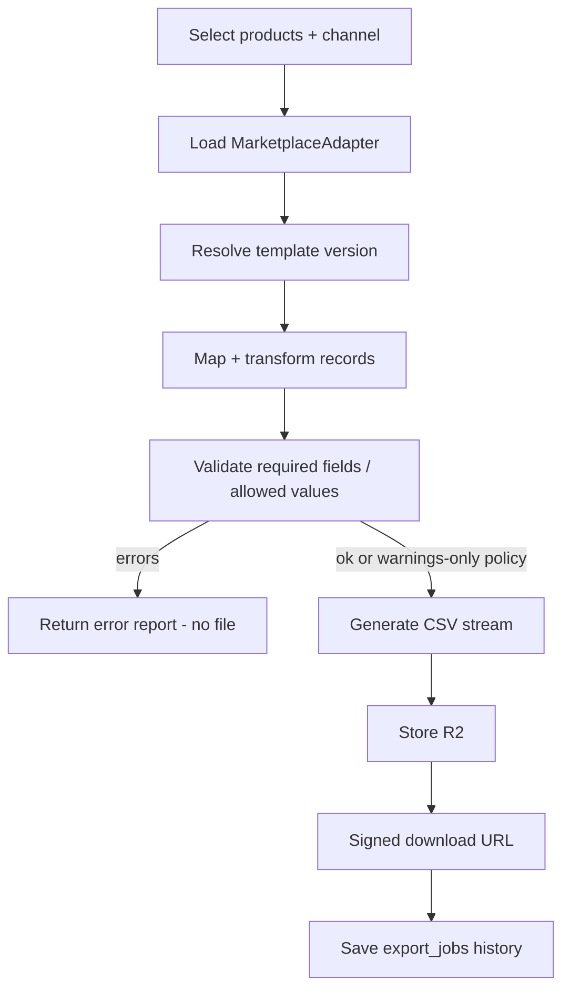

# CatalogPilot — Import & Export Engine Design

**Version:** 1.0  
**Criticality:** Highest technical risk area for MVP  

---

## 1. Goals

- Safely ingest large CSV catalogs without OOM or silent corruption  
- Deterministic mapping + preview before mutation  
- Background batched writes with resumability  
- Channel exports via adapters with pre-flight validation  
- Clear org ownership on every artifact  

---

## 2. Import workflow



### Step requirements

| Step | Rules |
|------|-------|
| 1 Upload | Authz editor+; plan product headroom check (soft warn / hard block if already at cap) |
| 2 Validate file | `.csv` MVP; max bytes from config; reject empty |
| 3 Store original | R2 key `org/{orgId}/imports/{importId}/source.csv`; compute SHA-256 |
| 4 Parse | Streaming parser only (never load full file into memory) |
| 5 Headers | First non-empty row; support UTF-8 BOM |
| 6 Map | Auto map by normalized header aliases; user override |
| 7 Preview | ≤50 rows; run same validators as commit |
| 8 Validate | File-level + row-level; blocking vs warnings |
| 9 Errors UI | Downloadable report after/during |
| 10 Confirm | Idempotency-Key; single active processing import per org **(recommended)** |
| 11 Batches | Transaction per batch; continue on row errors |
| 12 Results | Counters + error file |
| 13 Summary | API + Imports UI |

---

## 3. Detection details

### Encoding

1. If BOM `EF BB BF` → UTF-8  
2. Else try UTF-8 strict  
3. Else fallback Latin-1 / Windows-1252 with warning  

### Delimiter

Score `,` `;` `\t` `|` on header line consistency (column counts across sample lines).

### Column auto-map aliases (examples)

| Target | Aliases |
|--------|---------|
| sku | sku, SKU, Item SKU, Seller SKU |
| title | title, name, product title, item name |
| description | description, body, body html, product description |
| brand | brand, manufacturer, brand name |
| price | price, variant price, regular price |
| quantity | qty, quantity, inventory, stock |
| barcode | upc, ean, gtin, barcode |
| image_url | image, image src, main image |

---

## 4. Upsert semantics

**Modes**

- `create` — fail row if SKU exists  
- `upsert` — update existing SKU in same org  

**Concurrent imports:** MVP allows **one processing import per organization** (DB advisory lock or status check). Others queue or 409.

---

## 5. Failure prevention

| Risk | Mitigation |
|------|------------|
| Duplicate imports | Content hash warning; Idempotency-Key on confirm; UI confirm “file already imported” |
| Partial corruption | Per-batch transactions; no half-updated row; failed rows skipped |
| Memory issues | Stream parse; fixed batch size; limit preview |
| Concurrent conflicts | Single active import; SKU unique constraint; retry deadlocks |
| Lost jobs | Job row in DB + queue retry with backoff; reconcilersweep optional |
| Wrong org ownership | `organizationId` from server context only; R2 keys prefixed; never trust client org in worker without re-load |

---

## 6. Import rollback strategy

**Eligible when:** import `completed` and rollback window open (e.g., 24–72h) **[config]**.

1. Soft-delete products where `source_import_id = importId` AND not edited after import finish (no newer revision from other sources).  
2. For upserted SKUs: restore `before` snapshot from revisions written at import time (worker must snapshot on upsert).  
3. Mark remaining conflicts in rollback report.  
4. Set import `rolled_back`.  

If snapshots missing → rollback only “created” products; report partial.

---

## 7. Import pseudocode

```text
function handleUpload(ctx, file):
  assertRole(ctx, EDITOR)
  assertFileCsv(file)
  assertSize(file, MAX)
  importId = uuid()
  key = r2Key(ctx.orgId, importId, "source.csv")
  hash = sha256(file.stream)
  putR2(key, file.stream)
  detection = detectFormat(streamFromR2(key))
  suggestions = suggestMappings(detection.headers)
  db.insert(imports, { id: importId, org, key, hash, status: "uploaded", detection fields })
  return { importId, detection, suggestions }

function confirmImport(ctx, importId, idempotencyKey):
  assertRole(ctx, EDITOR)
  imp = loadImport(ctx.orgId, importId)
  assertStatus(imp, ["validated", "mapped"]) // after preview
  if not tryAcquireOrgImportLock(ctx.orgId): conflict()
  if alreadyProcessed(idempotencyKey): return existing
  imp.status = "queued"
  enqueue("import.process", { importId, organizationId: ctx.orgId })

function processImport(message):
  imp = load(message.importId)
  assert imp.organizationId == message.organizationId
  imp.status = "processing"
  parser = streamCsv(imp)
  batch = []
  for row in parser:
    mapped = applyMapping(row, imp.mappings)
    errors = validateRow(mapped)
    if errors.blocking: recordFailure(row); continue
    batch.append(mapped)
    if batch.length >= BATCH:
      commitBatch(imp, batch); batch.clear()
  commitBatch(imp, batch)
  writeErrorReport(imp)
  imp.status = finalizeStatus(imp)
  releaseLock(imp.organizationId)
  enqueue("validation.run", { organizationId, scope: "post_import", importId })

function commitBatch(imp, rows):
  with transaction:
    for r in rows:
      existing = findProduct(imp.organizationId, r.sku)
      if existing and imp.mode == "create": fail row
      if existing and imp.mode == "upsert":
        snapshotRevision(existing)
        updateProduct(existing, r, source_import_id=imp.id)
      else:
        insertProduct(r, organization_id=imp.organizationId, source_import_id=imp.id)
```

---

## 8. Export workflow



### Steps

1. Select products (IDs or filter) — always org-scoped  
2. Select marketplace + template version  
3. Apply field mapping (adapter)  
4. Validate required fields  
5. Transform (money format, HTML strip, etc.)  
6. Generate file streaming  
7. Store R2  
8. Download via signed URL  
9. History in `export_jobs`  

**Plan limits:** increment `import_export_jobs` usage on confirm of import **and** creation of export.

---

## 9. Export pseudocode

```text
function createExport(ctx, req):
  assertRole(ctx, EDITOR)
  assertWithinJobLimit(ctx.orgId)
  channel = getChannel(req.channelCode)
  template = getTemplate(channel, req.templateVersion)
  adapter = adapterRegistry.get(channel.code)
  products = loadProducts(ctx.orgId, req.scope)
  job = insertExportJob(queued)
  enqueue("export.generate", { jobId, organizationId: ctx.orgId })
  return job

function generateExport(message):
  job = load(message.jobId)
  adapter = adapterRegistry.get(job.channelCode)
  products = loadProducts(job)
  results = []
  errors = []
  for p in products:
    record = adapter.transform(p, job.template)
    v = adapter.validate(record, job.template)
    if v.errors: errors.append(...); continue
    results.append(record)
  if policyRequiresZeroErrors and errors: fail job with report
  key = writeCsvR2(job, adapter.headers(template), results)
  job.file_r2_key = key
  job.status = "completed"
  incrementUsage(job.organizationId, "import_export_jobs", 1)
```

---

## 10. CSV edge cases (must handle)

| Case | Behavior |
|------|----------|
| UTF-8 BOM | Strip BOM; detect utf-8-sig |
| Quoted commas | RFC4180 parser |
| Delimiters `;` / tab / `|` | Auto-detect + override |
| Empty cells | null / empty string per field rules |
| Duplicate SKUs in file | Block or first-wins with errors — **recommend fail duplicates in file** |
| Invalid barcodes | Row warning or error per rule severity |
| Missing headers | Fail upload detection |
| Large files | Stream + queue; size cap |
| Malformed rows | Record error; continue |
| Re-import same hash | Warn; allow with confirm |
| Concurrent imports | One active processor per org |

---

## 11. Performance targets (engineering goals)

| Scenario | Goal |
|----------|------|
| 10k-row import | Finish < 10 minutes |
| Preview 50 rows | < 3 seconds |
| Export 10k Shopify rows | < 5 minutes |
| Worker memory | Stable streaming; no full DOM of file |

Not contractual SLAs.

---

## 12. Testing hooks

See [TESTING_STRATEGY.md](../development/TESTING_STRATEGY.md) for concrete fixtures (BOM, quotes, delimiter, cross-tenant).
