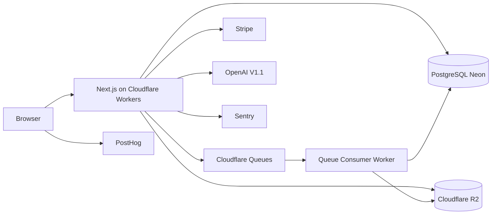

# CatalogPilot — System Architecture

**Version:** 1.0  
**Audience:** Implementers (human or AI coding agents)  
**Constraint:** Realistic for a solo developer with AI tooling; no microservices sprawl.

---

## 1. Architectural principles

1. **Modular monolith** — one Next.js application with clear domain modules.  
2. **Organization-scoped tenancy** — every tenant row carries `organization_id`; enforced in server services.  
3. **Async for heavy work** — imports, validation sweeps, bulk edits, exports run via queues.  
4. **Adapters at the edge** — marketplace logic behind `MarketplaceAdapter`; core product model stays channel-agnostic.  
5. **Config over code** — plan limits, validation rule toggles, adapter mapping versions stored as data.  
6. **Honesty** — CSV/template export ≠ API integration.

---

## 2. Recommended stack (with decisions)

| Layer | Choice | Rationale |
|-------|--------|-----------|
| Frontend | Next.js (App Router) + TypeScript + Tailwind + shadcn/ui | Fast SaaS UI; one language |
| Backend | Next.js Route Handlers + server modules | Avoid separate API service for MVP |
| Auth | **Better Auth** (recommended) | See §2.1 |
| DB | PostgreSQL + **Drizzle ORM** | SQL control; typed schema; migrations |
| DB hosting | **Neon** (recommended) or any Postgres 15+ | Serverless-friendly; branching for previews |
| Files | **Cloudflare R2** | S3-compatible; egress-friendly |
| Queue | **Cloudflare Queues** + Worker consumer | Reliable background jobs on CF |
| App hosting | **Cloudflare Workers via OpenNext** *if* validated in Phase 1 spike; else **Vercel** | See §2.2 |
| AI | OpenAI API (V1.1+) | Structured Outputs / JSON schema |
| Payments | Stripe Billing | Checkout + Portal + webhooks |
| Tests | Vitest + Playwright | Unit/integration + E2E |
| Observability | Sentry + PostHog | Errors + product analytics |
| CI | GitHub Actions | lint, typecheck, test, e2e smoke |

### 2.1 Auth recommendation: Better Auth over Clerk

| Criterion | Better Auth | Clerk |
|-----------|-------------|-------|
| Cost at early stage | Self-hosted, no MAU tax | Generous free tier then paid |
| Org/multi-tenant | First-class org plugins; full control | Excellent orgs; less DB ownership |
| Cloudflare Workers | Compatible with care; session in DB/KV | Hosted; edge helpers |
| Data ownership | Users/sessions in your Postgres | External IdP |
| Solo-dev speed | Slightly more setup | Faster initial UI |

**Recommendation: Better Auth** — keeps `users`, sessions, and organization membership in the same Postgres database as products, simplifying joins, backups, and org isolation tests. Revisit Clerk if auth setup becomes a schedule risk.

**Provisional assumption:** Use Better Auth with email/password + organization plugin; magic link optional later.

### 2.2 Hosting decision

**Spike in Phase 1 (mandatory before locking):**

1. Deploy Next.js via `@opennextjs/cloudflare` (or current OpenNext CF adapter).  
2. Confirm: Node compatibility, Drizzle + Neon (via `DATABASE_URL` / Hyperdrive), R2 bindings, Queue producer from Worker.  
3. Confirm max request CPU/duration sufficient for API handlers (not for full CSV parse — queues handle that).

**If OpenNext-on-CF fails spike:** Host Next.js on **Vercel**; keep **R2** for files; run queue consumers as **Cloudflare Workers** subscribed to Queues *or* use a simple alternative: **Inngest** / **Trigger.dev** / **Vercel Queues** (pick one) — document the choice in a short ADR. Prefer one queue system only.

**Default planning assumption:** Cloudflare Workers (OpenNext) + Queues + R2 + Neon Postgres.



---

## 3. High-level module map

```
apps/web (or repo root Next.js)
├── app/                    # UI routes
├── app/api/                # Route handlers
├── server/
│   ├── auth/               # Better Auth config
│   ├── db/                 # Drizzle schema + client
│   ├── services/           # Domain services (org-scoped)
│   ├── jobs/               # Enqueue helpers + handlers
│   ├── adapters/marketplaces/
│   ├── validation/rules/
│   └── billing/
├── workers/                # Queue consumer entry (if separate)
└── tests/
```

**Domain services (suggested)**

- `OrganizationService`, `ProductService`, `ImportService`, `ValidationService`, `BulkEditService`, `ExportService`, `BillingService`, `UsageService`, `ActivityLogService`

Route handlers stay thin: auth → parse → authorize → service → response.

---

## 4. Multi-tenant security model

1. Session identifies `userId`.  
2. Request includes `organizationId` (header `X-Organization-Id` or path); must match membership.  
3. Services accept `ctx: { userId, organizationId, role }`.  
4. All queries: `WHERE organization_id = ctx.organizationId`.  
5. Never trust client-provided org on nested resources without membership check.  
6. Prefer **404** for cross-tenant resource IDs to reduce enumeration.

Details: [SECURITY.md](./SECURITY.md), [DATABASE_SCHEMA.md](./DATABASE_SCHEMA.md).

---

## 5. Background job model

| Job type | Producer | Consumer work |
|----------|----------|---------------|
| `import.process` | API after confirm | Batch upsert products |
| `validation.run` | API / post-import hook | Emit issues + scores |
| `bulk_edit.apply` | API after preview confirm | Apply + snapshot |
| `export.generate` | API | Build CSV → R2 |
| `billing.reconcile` | webhook fallback | Optional |

**Job record** in Postgres (`job_runs` or type-specific tables) for status UI; Queue message carries `{ jobId, organizationId, type }`.

**Idempotency:** consumers check job status; use idempotency keys on Stripe and import confirm.

---

## 6. File storage layout (R2)

```
org/{organizationId}/imports/{importId}/source.csv
org/{organizationId}/imports/{importId}/errors.csv
org/{organizationId}/exports/{exportId}/output.csv
org/{organizationId}/images/{imageId}/original  # V1.1
```

Access via **short-lived signed URLs**; no public buckets for tenant data.

---

## 7. AI architecture (V1.1 preview)

- Server-only OpenAI calls  
- Prompt + product facts → JSON schema validate → store `ai_generations` as `proposed`  
- User approves → product update + usage increment  
- Hard monthly credit limits from plan config  

---

## 8. Billing architecture

- Stripe Customer per organization (not per user)  
- Checkout Session for subscribe/upgrade  
- Customer Portal for cancel/payment method  
- Webhooks: `checkout.session.completed`, `customer.subscription.*`, `invoice.*`  
- Local `subscriptions` + `plans` / `plan_limits` tables drive gates  
- `usage_records` for products count, jobs count, AI credits  

---

## 9. What we deliberately do not build yet

- Separate microservice per module  
- Event bus / Kafka  
- Kubernetes  
- Multi-region active-active  
- CQRS/Event sourcing (except pragmatic import snapshots / activity logs)  

---

## 10. Phase 1 spike checklist

- [ ] Next.js app boots  
- [ ] Drizzle migrates on Neon  
- [ ] Better Auth login works  
- [ ] R2 put/get signed URL  
- [ ] Enqueue + consume one test job  
- [ ] Sentry test error  
- [ ] Hosting path chosen (CF OpenNext vs fallback)  

Only after spike: implement product modules.
