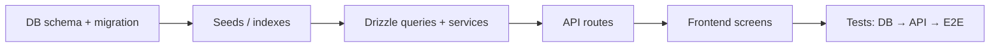
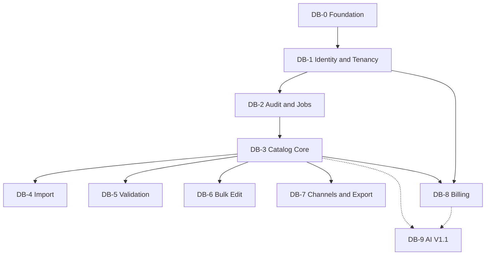

# CatalogPilot — Database Phases (Database → Frontend)

**Version:** 1.0  
**Principle:** For every product domain, ship in this order: **schema/migrations → seed data → repository/service layer → API → UI**. Do not build UI against unfinished tables.

This document is the **source of truth for database delivery order**. The overall product roadmap in [DEVELOPMENT_ROADMAP.md](./DEVELOPMENT_ROADMAP.md) follows these DB phases.

Full table specs: [DATABASE_SCHEMA.md](../architecture/DATABASE_SCHEMA.md).

---

## 1. Delivery rule (every domain)



**Never:** design screens that invent fields not yet in the schema.  
**Always:** migration merges before API/UI work for that domain.

---

## 2. Database phase overview

| DB Phase | Name | Tables | Unlocks |
|----------|------|--------|---------|
| **DB-0** | Database foundation | Tooling only | All later migrations |
| **DB-1** | Identity & tenancy | users, auth tables, organizations, organization_members, organization_invites | Auth + org UI |
| **DB-2** | Audit primitives | activity_logs, job_runs | Auditing + queue status for all modules |
| **DB-3** | Catalog core | categories, products, product_variants, product_attributes, product_images, product_revisions | Product API + catalog UI |
| **DB-4** | Import engine | imports, import_mappings, import_rows | Import API + wizard UI |
| **DB-5** | Data quality | validation_rules, validation_runs, validation_issues | Validation API + Data Quality UI |
| **DB-6** | Bulk editor | bulk_edit_jobs, bulk_edit_changes | Bulk API + Bulk Editor UI |
| **DB-7** | Channels & export | channels, marketplace_templates, channel_listings, export_jobs | Export API + Exports UI |
| **DB-8** | Billing & usage | plans, plan_limits, subscriptions, usage_records | Billing API + Billing UI |
| **DB-9** | AI (post-MVP) | ai_generations | AI Studio V1.1 |



---

## 3. Phase details

### DB-0 — Database foundation

**Objective:** Postgres reachable; migrations reproducible; Drizzle configured.

**Deliverables**
- PostgreSQL 15+ (Neon recommended)
- Drizzle ORM + Drizzle Kit
- `drizzle.config.ts`, migration folder, `db:generate` / `db:migrate` scripts
- `.env.example` with `DATABASE_URL`
- Empty baseline migration (or initial stub)
- CI step that applies migrations against ephemeral Postgres

**Tasks**
1. Provision Neon (or local Docker Postgres)  
2. Wire Drizzle client (`server/db/client.ts`)  
3. Add migration npm scripts  
4. Document connection for Workers/Node (Hyperdrive / serverless driver decision)  
5. CI: migrate + smoke `SELECT 1`  

**Dependencies:** Product Phase 0/1 app scaffold (or can run as first infra task)  

**Effort:** 2–3 sessions  

**Acceptance criteria**
- [x] Fresh database reaches schema version 0/baseline via one command (`pnpm db:migrate`)  
- [x] TypeScript `db` client compiles  
- [x] CI migration job configured (`.github/workflows/ci.yml`)  

**Status:** Completed 2026-10-30 — baseline migration enables `pgcrypto`; Vitest DB smoke included.

**Tests:** migration apply smoke + `select 1` + extension check  

**Frontend:** none  

**Definition of Done:** DB-0 checklist + [DEFINITION_OF_DONE.md](./DEFINITION_OF_DONE.md) infra items 

---

### DB-1 — Identity & tenancy

**Objective:** Multi-tenant root tables exist; every later table can FK to `organizations`.

**Tables**
| Table | Purpose |
|-------|---------|
| `users` | App users (align with Better Auth) |
| Better Auth auxiliaries | `sessions`, `accounts`, `verifications` (per Better Auth schema) |
| `organizations` | Tenant root |
| `organization_members` | User↔org + role |
| `organization_invites` | Email invites |

**Constraints / indexes (must ship in this migration)**
- Unique `users.email`  
- Unique `organizations.slug`  
- Unique `(organization_id, user_id)` on members  
- Indexes on `organization_members.user_id`  

**Seeds:** none required (roles are enums/text checks)

**Service layer next:** `OrganizationService`, auth config  

**API next:** register/login, orgs, members, invites  

**Frontend next:** auth screens, create org, org switcher, settings/members  

**Effort:** 3–5 sessions (schema + auth wiring often combined)  

**Acceptance criteria**
- [x] Cannot insert `organization_members` without valid org + user  
- [x] Integration test: two orgs, membership isolated  
- [x] Role column restricted to `owner|admin|editor|viewer` (check constraint or app enum + tests)  
- [x] Better Auth `sessions`, `accounts`, `verifications` (`0003_phase2_auth_tables.sql`)  

**Status:** Tenancy schema completed 2026-10-30. Auth auxiliary tables added in Phase 2.

**Tests:** FK integrity; unique membership; invite token hash stored (not raw token)  

---

### DB-2 — Audit & job primitives

**Objective:** Shared logging and background job mirror before domain jobs write data.

**Tables**
| Table | Purpose |
|-------|---------|
| `activity_logs` | Audit trail for mutations |
| `job_runs` | Optional unified queue status mirror |

**Why before catalog/import:** import, validation, bulk, and export all need job status + audit; creating these first avoids retrofit migrations.

**Indexes:** `(organization_id, created_at DESC)` on both  

**Service next:** `ActivityLogService`, job status helpers  

**API next:** (internal); dashboard may read job summaries later  

**Frontend next:** none required yet (status badges appear with domain UIs)  

**Effort:** 1–2 sessions  

**Acceptance criteria**
- [x] Insert activity log scoped by `organization_id`  
- [x] `job_runs` can represent `queued|processing|completed|failed`  

**Status:** Completed 2026-10-30 — `0002_db2_audit_jobs.sql`, `recordActivity` / `listActivityLogs`, and job run status helpers.  

---

### DB-3 — Catalog core

**Objective:** Canonical product model ready for CRUD and later import upserts.

**Tables (migration order within phase)**
1. `categories`  
2. `products`  
3. `product_variants`  
4. `product_attributes`  
5. `product_images`  
6. `product_revisions`  

**Critical constraints**
- Unique `(organization_id, sku)` on `products` (and variants) where not deleted  
- FK `products.organization_id` → `organizations`  
- Denormalized `organization_id` on child tables for tenant filters  
- Indexes: `(organization_id, updated_at)`, `(organization_id, status)`, `(organization_id, barcode)`  

**Seeds:** optional demo category per org (created at org creation time in app, not global seed)

**Service next:** `ProductService`, category helpers, revision writer  

**API next:** `/api/v1/products` CRUD, variants, history  

**Frontend next:** Products list, detail/edit, empty states  

**Effort:** 4–6 sessions  

**Acceptance criteria**
- [x] Duplicate SKU in same org fails at DB or service+DB  
- [x] Soft delete via `deleted_at` supported  
- [x] Updating a product writes a `product_revisions` row  
- [x] Cross-org product fetch by id returns nothing when scoped correctly  

**Status:** Completed 2026-10-30 — `0004_db3_catalog_core.sql` (numbered 0004 because Phase 2 auth tables used 0003). `source_import_id` is a nullable uuid with no foreign key until DB-4. Product SKU uniqueness is partial (`deleted_at IS NULL`). Variant SKUs are unique per organization; soft-deleting a product removes its variant rows so those SKUs can be reused. `hasIssues` stays out of the list API until DB-5.

**Tests:** unique SKU; cascade/restrict FK behavior documented; list query uses indexes (explain optional)  

---

### DB-4 — Import engine

**Objective:** Persist upload metadata, mappings, row errors, and link created products via `source_import_id`.

**Tables**
| Table | Purpose |
|-------|---------|
| `imports` | Job header, R2 key, hash, status, counters |
| `import_mappings` | Column map for a job |
| `import_rows` | Failed/preview rows (prefer failed-only at scale) |

**Also in this phase**
- Ensure `products.source_import_id` FK → `imports` (added in DB-3 as nullable FK; verify migration order—if imports did not exist in DB-3, add FK here)

**Recommended migration note:** If DB-3 created `source_import_id` without FK, DB-4 adds the FK once `imports` exists.

**Service next:** `ImportService`, detection helpers, worker batch writer  

**API next:** upload → mapping → preview → confirm → status → errors → rollback  

**Frontend next:** Imports list + import wizard  

**Effort:** 3–4 sessions (schema); worker/UI tracked in product Phase Import  

**Acceptance criteria**
- [x] Import row always has `organization_id`  
- [x] Status enum covers uploaded→rolled_back lifecycle  
- [x] Index `(organization_id, file_content_hash)` exists  
- [x] Rollback can find products by `source_import_id`  

**Status:** Completed 2026-10-30 — `0005_db4_import_engine.sql`. `products.source_import_id` now references `imports` and is set on rows this import creates. Upserted products keep their previous id and are restored from the pre-import revision. File bytes are stored under the R2 key layout in local `.data/object-store` until an R2 binding exists. Confirm runs `import.process` in the request, in batches of 200, and records a `job_runs` row. A duplicate content hash warns and does not block. A completed import with written rows starts a `post_import` validation run.

**Tests:** org-scoped import listing; orphan mapping prevented by FK  

---

### DB-5 — Data quality

**Objective:** Store rules, runs, and issues; cache scores on products.

**Tables**
| Table | Purpose |
|-------|---------|
| `validation_rules` | System + per-org rule config |
| `validation_runs` | Job executions |
| `validation_issues` | Per-product findings |

**Also:** confirm `products.quality_score` column exists (from DB-3)

**Seeds (required):** system default rules (`missing_title`, `invalid_sku`, `duplicate_sku`, `invalid_barcode`, `duplicate_barcode`, `missing_image`, `invalid_price`, `missing_description`, `missing_brand`, …)

**Service next:** rule runner, score calculator  

**API next:** runs, issues, rules patch, summary  

**Frontend next:** Data Quality screens  

**Effort:** 2–4 sessions  

**Acceptance criteria**
- [x] Seed rules present after migrate  
- [x] Issues FK to products + org  
- [x] Indexes for `(organization_id, status, severity)`  

**Status:** Completed 2026-10-30 — `0006_db5_data_quality.sql` (numbered 0006 because Phase 2 auth used 0003). Twelve system rules are seeded with `organization_id` null. An org override is a separate row. Score is `100 − 25×critical − 10×error − 3×warning − 1×info`, ignoring ignored issues, clamped to 0–100. Runs execute in the request and record `validation.run`. Editors may ignore warning and info; admins may also ignore error; critical cannot be ignored. Severity changes stay inside each rule's `config_json` bounds.

**Tests:** bare product scores 70; duplicate barcode; ignore and severity bounds; cross-org 404; post-import issues  

---

### DB-6 — Bulk editor

**Objective:** Job + per-product before/after snapshots for apply and undo.

**Tables**
| Table | Purpose |
|-------|---------|
| `bulk_edit_jobs` | Operation + config + status |
| `bulk_edit_changes` | `before_json` / `after_json` snapshots |

**Service next:** preview + apply worker  

**API next:** preview, create, rollback  

**Frontend next:** Bulk Editor wizard  

**Effort:** 1–2 sessions  

**Acceptance criteria**
- [x] Changes always include `organization_id` + `product_id`  
- [x] `can_rollback` flag supported on jobs  

**Status:** Completed 2026-10-31 — `0007_db6_bulk_editor.sql` (numbered 0007 because Phase 2 auth used 0003). Jobs store the operation and config. Each changed product stores `before_json` and `after_json`, and both columns are required along with `organization_id` and `product_id`. `can_rollback` is true only after a completed apply that wrote snapshots. Preview does not write. Apply runs in the request, updates each changed product, stores its snapshot, records `bulk_edit.apply`, and writes a product revision with change source `bulk:{jobId}`. Editors can preview and apply. Admins can undo a completed job; products edited after the job are left alone. A filter that matches more than 500 products is rejected.

**Tests:** text replace preview and apply; select-all-matching append; price percent undo restores the previous price; editor cannot undo; cross-org 404  

---

### DB-7 — Channels & export

**Objective:** Channel-agnostic export metadata; no marketplace columns on `products`.

**Tables**
| Table | Purpose |
|-------|---------|
| `channels` | `shopify`, `amazon`, … |
| `marketplace_templates` | Versioned mapping JSON |
| `channel_listings` | Optional per-product channel state |
| `export_jobs` | Export history + R2 key |

**Seeds (required)**
- Channels: `shopify` (`csv_template`), `amazon` (`csv_template`)  
- Templates: `2026.1` default mapping schemas  

**Service next:** adapter registry reading templates  

**API next:** channels list, create export, download  

**Frontend next:** Exports + light Channels page  

**Effort:** 2–3 sessions  

**Acceptance criteria**
- [x] Unique `(channel_id, version)` on templates  
- [x] Export job cannot reference wrong org’s products via service tests  
- [x] Seeds insert idempotently  

**Status:** Completed 2026-10-31 — `0008_db7_channels_export.sql` (numbered 0008 because Phase 2 auth used 0003). Shopify and Amazon are seeded as `csv_template` channels with default template `2026.1`. The inserts use `ON CONFLICT DO NOTHING`. Export runs validation first and fails the job when open critical or error issues remain. CSV bytes use the R2 key layout under local `.data/object-store`. A completed job exposes a 15-minute signed download URL. This is file export only.

**Tests:** Shopify and Amazon golden CSV files; variant rows; unknown channel; broken product blocked; cross-org 404; signed download  

---

### DB-8 — Billing & usage

**Objective:** Configurable plans/limits without code redeploys for price/limit tweaks.

**Tables**
| Table | Purpose |
|-------|---------|
| `plans` | starter / growth / pro |
| `plan_limits` | key/value limits |
| `subscriptions` | Stripe linkage per org |
| `usage_records` | Period metrics |

**Seeds:** three plans + limit rows (`max_products`, `max_import_export_jobs_monthly`, `max_members`, `export_templates`, `max_ai_credits_monthly=0` until AI)

**Service next:** `BillingService`, `UsageService`, gate helpers  

**API next:** plans, checkout, portal, webhook, usage  

**Frontend next:** Billing settings  

**Effort:** 2–3 sessions  

**Acceptance criteria**
- [x] One subscription row per organization (unique)  
- [x] Limits readable by plan code without hardcoding in services  
- [x] Usage unique on `(organization_id, period_start, metric)`  

**Status:** Completed 2026-10-31 — `0009_db8_billing_usage.sql` (numbered 0009 because Phase 2 auth used 0003 and channels used 0008). Seeds Starter, Growth, and Pro. Product and monthly job caps follow the PRD table; Pro jobs are seeded at 500. AI credits are 0. Every plan’s `export_templates` value includes both MVP CSV templates so a trial can export Shopify and Amazon; the integer cap is data and can be lowered without a code change. New organizations start a 14-day Starter trial from `trial_days`. Checkout and the customer portal call Stripe when `STRIPE_SECRET_KEY` and a monthly price id are set. Webhooks are verified and ignored when the same event id was already applied. Product create, invites, import confirm, and export are blocked at the plan limit.

**Tests:** one subscription per org; limits read from `plan_limits`; usage upsert stays one row; product and member gates; owner-only Checkout; webhook applied once  

---

### DB-9 — AI generations (V1.1 only)

**Tables:** `ai_generations`  

**Do not migrate in MVP** unless explicitly approved early.

**Acceptance (when built):** proposed/approved/rejected statuses; token/cost columns; org + product FKs  

---

## 4. Mapping: DB phases → product implementation phases

| After completing… | Build next (API → UI) |
|-------------------|------------------------|
| DB-0 | App scaffold / CI only |
| DB-1 | Auth + Organizations UI |
| DB-2 | (helpers only) |
| DB-3 | Product Catalog API + UI |
| DB-4 | Import API + wizard UI |
| DB-5 | Validation API + Data Quality UI |
| DB-6 | Bulk Editor API + UI |
| DB-7 | Export API + UI |
| DB-8 | Billing API + UI |
| DB-9 | AI Studio |

**Vertical slice example (catalog):**

1. Merge DB-3 migration  
2. ProductService + Vitest  
3. REST endpoints  
4. Products pages  
5. Playwright list/edit smoke  

---

## 5. Migration naming convention

```text
0000_db0_foundation.sql          # optional baseline
0001_db1_identity_tenancy.sql
0002_db2_audit_jobs.sql
0003_db3_catalog_core.sql
0004_db4_import_engine.sql
0005_db5_data_quality.sql
0006_db6_bulk_editor.sql
0007_db7_channels_export.sql
0008_db8_billing_usage.sql
0009_db9_ai_generations.sql      # V1.1
```

One logical DB phase = one (or few tightly related) migration files. Never edit applied migrations.

---

## 6. Cross-cutting database rules (all phases)

1. Tenant-owned tables **must** include `organization_id NOT NULL`.  
2. Prefer UUID PKs + `timestamptz`.  
3. Uniques are **per organization**, not global (except users.email, channel codes, plan codes).  
4. Add indexes in the same migration as the table.  
5. Seeds for system data (rules, channels, plans) are part of phase DoD.  
6. Integration tests run against a real Postgres whenever FKs/uniques matter.  

---

## 7. MVP database completion gate

MVP schema is complete when **DB-0 through DB-8** are migrated, seeded, and covered by integration tests.  
**DB-9 is explicitly out of MVP.**

---

## 8. Suggested GitHub issues (database epic)

See also [GITHUB_ISSUES.md](./GITHUB_ISSUES.md) — epic **E-DB**.

- `db-0`: foundation tooling  
- `db-1`: identity & tenancy migration  
- `db-2`: activity_logs + job_runs  
- `db-3`: catalog core migration + ProductService  
- `db-4` … `db-8`: as above  
- `db-9`: AI (P1)  
