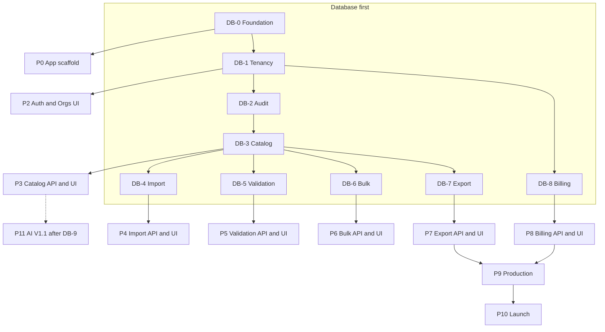

# CatalogPilot — Development Roadmap

**Version:** 1.1  
**Assumption:** Solo developer, **10–15 hours/week**, AI-assisted (Cursor), small testable increments.  

**Effort units:** “sessions” ≈ 3–4 focused hours. Estimates are for planning, not calendar commitments.

**Delivery order (mandatory):** **Database → services → API → frontend** for each domain.  
Detailed DB breakdown: **[DATABASE_PHASES.md](./DATABASE_PHASES.md)** (source of truth for schema order).

**Total MVP estimate:** ~90–130 sessions ≈ **270–520 hours** wall-effort → roughly **6–12 months** at 10–15 h/week depending on experience and cut decisions.  
See MVP_SCOPE cuts if schedule pressure appears.

---

## 0. How phases work

Each **product phase** below starts only after its **DB phase** migration is merged (or is that DB phase).

| Step | Work |
|------|------|
| 1 | Schema + migration + seeds + indexes ([DATABASE_PHASES.md](./DATABASE_PHASES.md)) |
| 2 | Drizzle queries + domain services |
| 3 | REST API |
| 4 | UI screens |
| 5 | Tests at each layer |

---

## Database phases (summary)

| ID | Name | Tables (short) |
|----|------|----------------|
| **DB-0** | Foundation | Drizzle/Neon tooling, CI migrate |
| **DB-1** | Identity & tenancy | users, orgs, members, invites, auth sessions |
| **DB-2** | Audit & jobs | activity_logs, job_runs |
| **DB-3** | Catalog core | categories, products, variants, attributes, images, revisions |
| **DB-4** | Import | imports, import_mappings, import_rows |
| **DB-5** | Data quality | validation_rules, validation_runs, validation_issues |
| **DB-6** | Bulk edit | bulk_edit_jobs, bulk_edit_changes |
| **DB-7** | Channels & export | channels, marketplace_templates, channel_listings, export_jobs |
| **DB-8** | Billing & usage | plans, plan_limits, subscriptions, usage_records |
| **DB-9** | AI (V1.1) | ai_generations |

Full acceptance criteria, seeds, and migration names: [DATABASE_PHASES.md](./DATABASE_PHASES.md).

---

## Product phases

### Phase 0 — App foundation (parallel with DB-0)

**Objective:** Bootable Next.js app + CI + hosting spike.  
**DB gate:** Complete **DB-0** (migrations pipeline works).  

**Tasks:** Next.js + TS + Tailwind + shadcn; R2 helper; queue spike; OpenNext vs Vercel ADR; Sentry/PostHog stubs; GitHub Actions.

**Dependencies:** None  
**Effort:** 4–6 sessions  
**Acceptance:** App boots; CI green; DB migrate in CI; hosting ADR written  

---

### Phase 1 — Database: identity & tenancy (**DB-1**)

**Objective:** Multi-tenant schema is real before any product UI.  
**DB work only + auth schema alignment** (Better Auth tables).  

**Deliverables:** Migrations for users/orgs/members/invites; Better Auth DB tables; membership helpers.  

**Dependencies:** DB-0 / Phase 0  
**Effort:** 3–5 sessions  
**Acceptance:** See DB-1 in DATABASE_PHASES.md  
**Frontend:** none yet (except optional health check)  

---

### Phase 2 — Auth & organizations (API → UI)

**Objective:** Humans can register, verify, create orgs, invite members.  
**DB gate:** **DB-1** merged. Also apply **DB-2** (activity_logs) before mutating APIs if possible.

**Features:** Register/login/verify/reset; org create; members/invites; org switcher; role middleware.

**Dependencies:** Phase 1 (DB-1)  
**Effort:** 6–10 sessions  
**Acceptance:** US-A01–A09; cross-org denied  
**Tests:** unit roles; integration isolation; E2E register → org → login  

---

### Phase 3 — Database: catalog core (**DB-3**) then Catalog API → UI

**Objective:** Products exist in DB first, then services/API, then screens.  

**Step A — DB-3:** categories, products, variants, attributes, images, revisions (+ confirm DB-2 done)  
**Step B — API:** ProductService + `/api/v1/products`  
**Step C — UI:** list / detail / edit / empty states  

**Dependencies:** Phase 2  
**Effort:** 8–12 sessions (4–6 DB+service, rest API/UI)  
**Acceptance:** SKU unique per org; soft delete; revision on update; paginated list  

---

### Phase 4 — Database: import (**DB-4**) then Import API → UI

**Objective:** Import tables first; then pipeline and wizard.  

**Step A — DB-4:** imports, mappings, rows; FK `products.source_import_id`  
**Step B — API/worker:** upload, detect, map, preview, confirm, batches, rollback  
**Step C — UI:** Imports history + wizard  

**Dependencies:** Phase 3 (catalog tables); R2; queue  
**Effort:** 14–20 sessions  
**Acceptance:** 5k-row fixture; BOM/quotes/delimiter cases; org isolation  

---

### Phase 5 — Database: validation (**DB-5**) then Data Quality API → UI

**Step A — DB-5:** rules, runs, issues + seed rules  
**Step B — Runner job + score updates  
**Step C — Data Quality UI  

**Dependencies:** Phase 3  
**Effort:** 8–12 sessions  
**Acceptance:** Core rule severities; score 0–100; filter/ignore/re-run  

---

### Phase 6 — Database: bulk (**DB-6**) then Bulk Editor API → UI

**Step A — DB-6:** bulk_edit_jobs, bulk_edit_changes  
**Step B — Preview/apply/rollback APIs  
**Step C — Bulk Editor UI  

**Dependencies:** Phase 3; ideally Phase 5  
**Effort:** 8–10 sessions  
**Acceptance:** 500-product preview apply; undo when snapshotted  

---

### Phase 7 — Database: export (**DB-7**) then Export API → UI

**Step A — DB-7:** channels, templates, listings, export_jobs + seeds  
**Step B — MarketplaceAdapter + workers  
**Step C — Exports / Channels UI  

**Dependencies:** Phases 3 and 5 (validation before export)  
**Effort:** 8–12 sessions  
**Acceptance:** Shopify + Amazon CSV golden files; pre-export errors  

---

### Phase 8 — Database: billing (**DB-8**) then Billing API → UI

**Step A — DB-8:** plans, limits, subscriptions, usage + seeds  
**Step B — Stripe Checkout/Portal/webhooks/gates  
**Step C — Billing UI  

**Dependencies:** Phase 2 (orgs); gates applied to import/export  
**Effort:** 6–10 sessions  
**Acceptance:** Test-mode subscribe; webhook idempotency; limit CTA  

---

### Phase 9 — Production readiness

**Objective:** Harden for pilots (rate limits, backups drill, legal, monitoring).  
**Dependencies:** Phases 0–8  
**Effort:** 4–8 sessions  

---

### Phase 10 — Launch and customer validation

**Objective:** Pilots, feedback, later Product Hunt.  
**Dependencies:** Phase 9  
**Effort:** ongoing  

---

### Phase 11 — AI Studio (V1.1)

**DB gate:** **DB-9** (`ai_generations`)  
**Then:** API → review UI → credits  
**Dependencies:** Stable catalog loop + billing usage  
**Effort:** 8–14 sessions  

---

## Effort rollup (MVP = through Phase 9 production, no AI)

| Phase | Focus | Sessions |
|-------|--------|----------|
| 0 | App + DB-0 | 4–6 |
| 1 | DB-1 tenancy | 3–5 |
| 2 | Auth/orgs UI | 6–10 |
| 3 | DB-3 + catalog | 8–12 |
| 4 | DB-4 + import | 14–20 |
| 5 | DB-5 + validation | 8–12 |
| 6 | DB-6 + bulk | 8–10 |
| 7 | DB-7 + export | 8–12 |
| 8 | DB-8 + billing | 6–10 |
| 9 | Production | 4–8 |
| **Total** | | **~69–105 sessions** |

At 3–4 h/session and 12 h/week → order-of-magnitude **6–10+ months**.

---

## Branch strategy & commits

**Branches**
- `main` — production-ready  
- `cursor/<feature>-7c25` or `feat/<slug>` — feature branches  
- Prefer `feat/db-3-catalog-schema` before `feat/catalog-ui`  

**Commits (Conventional Commits)**
- `feat(db):`, `feat(api):`, `feat(ui):`, `fix:`, `docs:`, `chore:`, `test:`  
- Example: `feat(db): add DB-4 imports mappings and import_rows`  

**CI required on PR:** typecheck, lint, unit, critical integration; **migrations must apply cleanly**.
