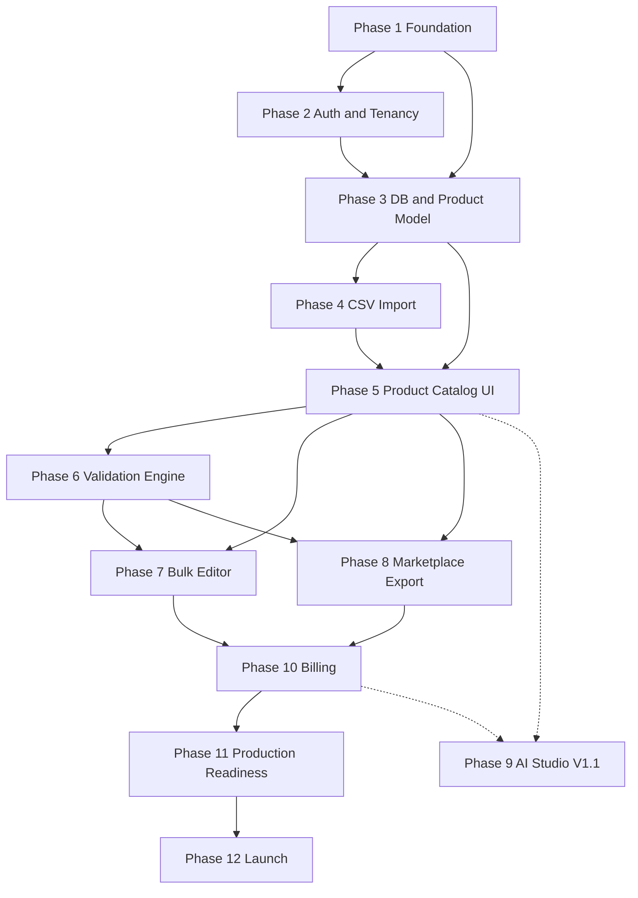

# CatalogPilot — Development Roadmap

**Version:** 1.0  
**Assumption:** Solo developer, **10–15 hours/week**, AI-assisted (Cursor), small testable increments.  

**Effort units:** “sessions” ≈ 3–4 focused hours. Estimates are for planning, not calendar commitments.

**Total MVP estimate:** ~90–130 sessions ≈ **270–520 hours** wall-effort → roughly **6–12 months** at 10–15 h/week depending on experience and cut decisions.  
See MVP_SCOPE cuts if schedule pressure appears.

---

## Dependency graph

Phase 9 (AI) is **after** MVP reliability — shown as dashed.

---

## Phase 1 — Project foundation

**Objective:** Bootable app, CI, hosting spike, tooling.

**Features:** Repo structure, Next.js, Tailwind, shadcn, Drizzle, lint, CI, env templates.

**Tasks**
1. Scaffold Next.js + TS + Tailwind + shadcn  
2. Drizzle + Neon connection  
3. Cloudflare R2 client helper  
4. Queue spike (enqueue/consume test)  
5. OpenNext-on-CF vs Vercel decision ADR  
6. GitHub Actions: typecheck, lint, unit test  
7. Sentry + PostHog stubs  

**Dependencies:** None  

**Effort:** 4–6 sessions  

**Deliverables:** Running hello app; ADR for hosting; CI green  

**Acceptance**
- `pnpm test` / `vitest` runs  
- Migration applies on empty DB  
- Test job round-trip works  

**Tests:** smoke unit; CI pipeline  

**DoD:** Definition of Done checklist for infra  

---

## Phase 2 — Authentication and multi-tenancy

**Objective:** Users, sessions, orgs, roles.

**Features:** Register/login/verify/reset; org create; members/invites; org switcher.

**Tasks:** Better Auth setup; org tables; membership middleware; UI shells for auth/settings.

**Dependencies:** Phase 1  

**Effort:** 8–12 sessions  

**Deliverables:** Auth flows + org isolation middleware  

**Acceptance:** US-A01–A09 core paths  

**Tests**
- Unit: role helpers  
- Integration: cross-org denied  
- E2E: register → create org → logout → login  

---

## Phase 3 — Database and product model

**Objective:** Product schema + services.

**Features:** products, variants, images URLs, categories, revisions, activity_logs.

**Tasks:** Migrations; ProductService CRUD; factories for tests.

**Dependencies:** Phase 2  

**Effort:** 6–8 sessions  

**Acceptance:** SKU unique per org; soft delete; revision on update  

**Tests:** unit service; integration unique constraint  

---

## Phase 4 — CSV import engine

**Objective:** End-to-end CSV import with background processing.

**Features:** Upload, detect, map, preview, confirm, worker, history, rollback soft.

**Dependencies:** Phases 1–3, R2, queue  

**Effort:** 14–20 sessions  

**Acceptance:** 5k-row fixture import; BOM/quotes/delimiter cases  

**Tests:** See TESTING_STRATEGY import cases; E2E wizard happy path  

---

## Phase 5 — Product catalog UI

**Objective:** List/detail/edit usable at scale.

**Features:** Search, filter, sort, pagination, detail tabs, empty states.

**Dependencies:** Phase 3; improved by Phase 4 data  

**Effort:** 8–12 sessions  

**Acceptance:** Paginate 10k seeded products without UI freeze (page size 50)  

**Tests:** E2E search/filter; component tests optional  

---

## Phase 6 — Validation engine

**Objective:** Rules, issues, scores, re-run jobs.

**Features:** Core rule pack; Data Quality UI; ignore/fix; post-import hook.

**Dependencies:** Phase 5  

**Effort:** 8–12 sessions  

**Acceptance:** Duplicate SKU/barcode, missing fields, invalid price/barcode produce correct severities; score updates  

**Tests:** unit each rule; integration run; E2E open issues filter  

---

## Phase 7 — Bulk editor

**Objective:** Safe multi-product mutations.

**Features:** Ops set; preview; job; history; rollback when snapshotted.

**Dependencies:** Phase 5; ideally Phase 6  

**Effort:** 8–10 sessions  

**Acceptance:** 500-product price % update with preview; undo restores  

**Tests:** unit transforms; integration rollback; E2E preview confirm  

---

## Phase 8 — Marketplace export

**Objective:** Adapter interface + Shopify + Amazon CSV.

**Features:** Channels UI light; export job; signed download; pre-validation.

**Dependencies:** Phases 5–6  

**Effort:** 8–12 sessions  

**Acceptance:** Golden CSV fixtures match; invalid products block with report  

**Tests:** adapter snapshots; E2E export download  

---

## Phase 9 — AI Studio (post-MVP / V1.1)

**Objective:** Review-before-apply enrichment.

**Dependencies:** Stable Phases 5–8 + billing usage meters  

**Effort:** 8–14 sessions  

**Acceptance:** No auto-apply; schema validation; credits enforced; no invented specs evals  

---

## Phase 10 — Billing

**Objective:** Stripe subscriptions + limits.

**Features:** plans seed; Checkout; Portal; webhooks; usage; trial; gates.

**Dependencies:** Orgs (Phase 2); gates on import/export (4/8)  

**Effort:** 6–10 sessions  

**Acceptance:** Test-mode subscribe; webhook updates status; limit blocks with CTA  

**Tests:** webhook signature + idempotency; E2E checkout in test mode if feasible  

---

## Phase 11 — Production readiness

**Objective:** Harden for real users.

**Features:** monitoring, backups drill, rate limits, legal pages, error budgets basics.

**Dependencies:** Phases 1–8, 10  

**Effort:** 4–8 sessions  

**Acceptance:** SECURITY checklist mostly complete  

---

## Phase 12 — Launch and customer validation

**Objective:** Pilots, feedback, PH readiness later.

**Tasks:** onboarding sample CSV; outreach; interview notes; triage bugs.

**Dependencies:** Phase 11  

**Effort:** ongoing  

**Acceptance:** ≥3 external users complete activation journey  

---

## Effort rollup (MVP without Phase 9)

| Phase | Sessions |
|-------|----------|
| 1 | 4–6 |
| 2 | 8–12 |
| 3 | 6–8 |
| 4 | 14–20 |
| 5 | 8–12 |
| 6 | 8–12 |
| 7 | 8–10 |
| 8 | 8–12 |
| 10 | 6–10 |
| 11 | 4–8 |
| **Total** | **~74–110 sessions** |

At 3–4 h/session and 12 h/week → order-of-magnitude **6–10+ months**. AI assistance may compress; import engine risk may expand.

---

## Branch strategy & commits

**Branches**
- `main` — production-ready  
- `cursor/<feature>-7c25` or `feat/<slug>` — feature branches  
- Short-lived PRs; squash or conventional merges  

**Commits (Conventional Commits)**
- `feat:`, `fix:`, `docs:`, `chore:`, `test:`, `refactor:`  
- Example: `feat(import): detect UTF-8 BOM and strip before parse`  

**CI required on PR:** typecheck, lint, unit, critical integration.
