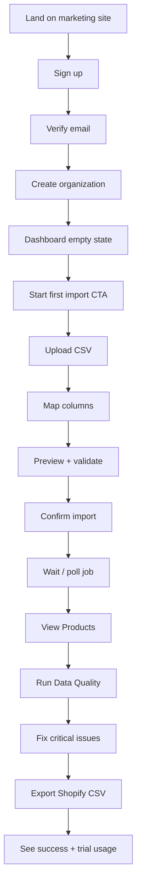

# CatalogPilot — User Journeys & UI/UX Requirements

**Version:** 1.0  
**Design direction:** Modern, minimal, professional B2B SaaS; light theme default; dense but readable data tables; responsive; efficient for large catalogs.

**Visual principles (implementation guidance)**

- Clean layout with clear hierarchy; avoid dashboard clutter on first paint of operational screens.  
- Light theme default (dark optional later).  
- Prefer shadcn/ui primitives: tables, dialogs, sheets, toasts, forms.  
- Empty / loading / error / success states on every primary screen.  
- Confirmation dialogs for destructive or mass-mutation actions.

---

## 1. Information architecture — main navigation

| Nav item | Purpose | MVP? |
|----------|---------|------|
| Dashboard | Status overview, next actions, usage | Yes |
| Products | Catalog list & detail | Yes |
| Imports | Upload, map, history | Yes |
| Data Quality | Issues, scores, re-run | Yes |
| Bulk Editor | Multi-product mutations | Yes |
| AI Studio | Generative enrichment | V1.1 (hide or “Coming soon”) |
| Channels | Channel profiles / templates metadata | MVP light (export targets) |
| Exports | Create & history | Yes |
| Automations | Schedules | V2 (hide) |
| Billing | Plan, usage, portal | Yes |
| Settings | Org, members, profile | Yes |

---

## 2. First-time user journey (activation)

### Step detail

1. **Signup** — email/password; clear value prop reminder.  
2. **Verify** — blocked or limited until verified (recommend hard gate for mutations).  
3. **Create org** — name + optional currency default (USD).  
4. **Dashboard empty** — single primary CTA: “Import your first catalog”. Secondary: sample CSV download.  
5. **Import wizard** — Upload → Detect → Map → Preview → Confirm.  
6. **Processing** — progress UI; email optional later; in-app toast + Imports page status.  
7. **Products** — celebrate first load; prompt “Check data quality”.  
8. **Quality** — show score + top Critical issues.  
9. **Export** — recommend Shopify; block with clear errors if required fields missing.  
10. **Billing nudge** — show trial days + product usage meter (non-blocking until limit).

**Activation metric:** steps 1–9 completed.

---

## 3. Screen specifications

### 3.1 Dashboard

**Purpose:** Orient user; surface blockers and usage.

**Components**

- Org switcher (header)  
- Trial/plan badge + usage meters (products, jobs)  
- Quality score summary (aggregate)  
- Cards/rows: recent imports, open Critical issues count, recent exports  
- Primary CTA when empty  

**States:** empty (no products), loading skeletons, error retry.

### 3.2 Products — list

**Purpose:** Browse and operate on catalog.

**Components**

- Search (SKU, title)  
- Filters: status, brand, category, quality score band, has issues  
- Sort: updated_at, sku, title, price, quality_score  
- Table columns: checkbox, SKU, title, brand, price, status, score, images count, updated  
- Bulk actions bar: Bulk Edit, Export, Validate, Archive  
- Pagination (cursor or offset; recommend cursor for large sets, offset OK MVP ≤50k)  

**States:** empty with import CTA; loading; error; no filter results.

### 3.3 Products — detail / edit

**Purpose:** Inspect and edit one product (+ variants).

**Components**

- Header: SKU, status, score, actions (Save, Validate, History)  
- Tabs/sections: General, Attributes, Images, Variants, History  
- Inline validation messages  
- Unsaved changes guard  

### 3.4 Imports — list

**Purpose:** History of jobs.

**Columns:** file name, status, rows total/success/failed, created_by, created_at, actions (view report, rollback if eligible).

### 3.5 Imports — wizard

**Steps**

1. Upload (drag-drop; type/size errors)  
2. Detection summary (encoding, delimiter, header row)  
3. Mapping table (source → target; required indicators)  
4. Preview table + validation summary  
5. Confirm options: create vs upsert by SKU; on-duplicate strategy  
6. Progress / result  

**Confirmations:** overwrite/upsert warnings.

### 3.6 Data Quality

**Purpose:** Triage and resolve issues.

**Components**

- Org score + distribution chart (simple)  
- Filters: severity, rule, status (open/ignored/resolved)  
- Issue table → deep link to product  
- Actions: Fix (opens editor or inline), Ignore, Bulk fix where supported  
- Re-run validation button (job)  

### 3.7 Bulk Editor

**Purpose:** Safe mass updates.

**Flow:** Select scope → Choose operation → Configure → Preview sample diffs → Confirm → Job progress → Summary.

**Confirmation:** irreversible warning if undo unavailable for operation type.

### 3.8 Channels (MVP light)

**Purpose:** List available export adapters/templates and versions.

Not a full channel connection UI in MVP (no OAuth to Shopify).

### 3.9 Exports

**List + create drawer/wizard:** channel → product scope → options → validate → generate → download.

### 3.10 AI Studio (V1.1)

Proposal inbox; never silent apply. Hidden in MVP nav or labeled Coming soon.

### 3.11 Automations (V2)

Hidden in MVP.

### 3.12 Billing

Plan comparison, usage, CTA to Checkout, link to Stripe Portal, invoice history (from Stripe).

### 3.13 Settings

Profile; organization settings; members & invites; API keys (later); danger zone (delete org — soft).

---

## 4. Cross-cutting UX patterns

| Pattern | Requirement |
|---------|-------------|
| Empty states | Illustration/simple graphic + one sentence + primary CTA |
| Loading | Skeletons for tables; spinners for actions; disable double-submit |
| Errors | Inline field errors; toast for transient; full-page for fatal |
| Success | Toast + optional undo snackbar for bulk when supported |
| Confirmations | Dialog for delete, rollback, bulk apply, export large scopes |
| Bulk actions | Sticky action bar when selection > 0 |
| Search/filters | Debounced search; clear-all filters |
| Permissions | Hide/disable actions; API still enforces |
| Large catalogs | Virtualize table if needed (V1.1); MVP page size 25/50/100 |

---

## 5. Secondary journeys

### Returning user — fix listing errors

Dashboard Critical count → Data Quality → filter Critical → fix → re-run → Export.

### Agency user — multi-org

Login → switch org → import client file → export → switch org.

### Limit hit

Action blocked modal → explain limit → Upgrade → Stripe Checkout → webhook unlocks.

### Bad import recovery

Imports → failed/partial → download error CSV → rollback if completed-with-issues → re-import.

---

## 6. Accessibility & responsiveness

- Keyboard-accessible dialogs and tables (as far as shadcn defaults allow)  
- Mobile: usable nav + stacked forms; complex tables may horizontal-scroll (acceptable for B2B MVP)  
- Do not block desktop workflows for mobile polish  

---

## 7. Copy tone

Professional, direct, non-hype. Prefer “12 Critical issues” over “Your catalog needs love!”. No emoji-required UI.
